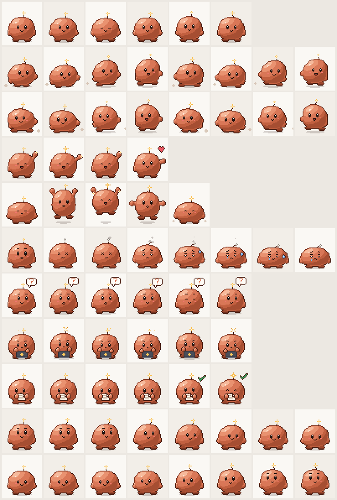

# Claude Pet

A small animated companion that floats above your windows and shows what your
Claude desktop **Code** sessions are doing, and your **Codex** threads too. It works like the
Pets feature in the ChatGPT/Codex desktop app and uses the same pet format, so ChatGPT/Codex
pets work here too.



## Install

The pet is built and tested on Windows. There are two ways to get it:

- **Download it.** This needs no Node.js or npm. On the
  [releases page](https://github.com/hyukjunlim/claude-pet/releases/latest), take
  `Claude-Pet-Setup-<version>.exe` or `Claude-Pet-<version>-win.zip`. The installer puts the
  pet in your user folder (no admin rights needed) and starts it; the zip you unzip anywhere and
  start with `Claude Pet.exe`. The app isn't code-signed, so Windows SmartScreen may warn the
  first time: choose *More info* → *Run anyway*.
- **Run it from the source**, as below. That's also the copy that updates itself with one click,
  and the one to hack on.

Both need something to watch:

- **The Claude desktop app** (with Code sessions), **Codex** ([Codex](#codex)), or both. That's
  what the pet watches. With only one of them, the tray menu leaves out the other's items, and
  clicking the pet opens the one you have. If you run Claude Code from a terminal instead (the
  `claude` CLI, here, in WSL or over SSH), there are no session bubbles for it, but the weekly
  limit still works ([Live Claude usage](#live-claude-usage)).

To run it from the source you also need **Git** and **Node.js 22.12 or newer** (the current LTS is
fine; `npm install` downloads Electron itself), and optionally Python, only to rebuild the
built-in pet.

```bash
git clone https://github.com/hyukjunlim/claude-pet.git
cd claude-pet
npm install
npm start
```

On its first start, the pet offers to set up a small mod for Claude Code, which is where it gets
Claude's weekly limit from ([Live Claude usage](#live-claude-usage)). Say *Set it up*, and that's
all.

It also offers a one-time, optional connection to SNU eTL. Choose *eTL 연결* to open the token
form, or *나중에* to skip it; you can connect later from the tray menu's *eTL* item.

To update, use **Check for updates…** in the tray menu ([Updating](#updating)).

> **Installed it before the tray had *Check for updates…*?** That version can't update itself, so
> do it by hand once: quit the pet from the tray menu, run `git pull` and then `npm install` in
> its folder, and start it again (`npm start`, or double-click `Claude Pet.lnk`). Your settings
> and pets are kept. If `git pull` complains about files you changed, undo those changes first.
> After this, updates are one click.

## Run it

```bash
npm start          # the pet appears in the bottom-right corner, plus a tray icon
npm run demo       # cycles through every status with fake sessions
npm test           # unit tests for the status logic
npm run shortcut   # creates "Claude Pet.lnk" in this folder (Windows)
node src/sessions.js   # print what the pet currently sees, then exit
npm run dist       # builds the installer and the zip into dist/ (Windows)
```

From its first run on, the pet starts at login; untick *Start at login* in the tray menu to stop
that. To start it yourself without a console window, double-click **Claude Pet.lnk** in this
folder. The flags `--start-at-login` and `--no-start-at-login` set the same option from the
command line. `Ctrl+Alt+P` shows or hides the pet. Right-click the pet
(or click the tray icon) for the menu, which also has *Restart Claude Pet* (after you edit its
code, say).

The pet logs what goes wrong (a crash, a link that wouldn't open) to `claude-pet.log` in
`%APPDATA%\claude-pet\logs` (`~/Library/Logs/claude-pet` on macOS). Past 1 MB it starts over and
keeps the previous log as `claude-pet.old.log`.

## Updating

**A downloaded copy** (installer or zip) can't update itself. Tray menu → **Check for updates…**
asks GitHub whether a newer release exists, shows what changed, and opens the download page. Quit
the pet, run the new installer (or replace the unzipped folder), and that's it: settings, pets and
the log live outside the app's folder, so nothing is lost. A copy from the source and a downloaded
one share those files too, so you can switch between the two.

**A copy from the source** updates itself. Tray menu → **Check for updates…** looks at the latest `main` on GitHub. If there's something new,
a dialog lists what changed; **Update and restart** closes the pet, updates the files, runs
`npm install` if `package.json` or the lockfile changed, and starts the pet again. A dialog then
says it worked, or why it didn't (the old version is kept, and the log has the details). It only
checks when you ask.

- **Your things are kept.** Settings, your pets and the log live outside this folder
  (`%APPDATA%\claude-pet` and `~/.claude-pet/pets`), so an update never touches them. Keep a
  customized pet in `~/.claude-pet/pets`, not in this folder's `pets/`.
- **It needs git** (the pet is a clone of this repo) and Node on your PATH, which the source
  install already asked for. It says why when it can't update: the folder isn't a git clone, isn't on
  `main`, has commits that aren't on GitHub's `main`, or has edited files that an update would
  overwrite. A lockfile that npm rewrote doesn't count.
- **Installed before this existed?** That version has no such menu item. Update it by hand once,
  as described under [Install](#install).

## Building the installer

`npm run dist` builds `Claude-Pet-Setup-<version>.exe` (a per-user installer) and
`Claude-Pet-<version>-win.zip` (unzip and run) into `dist/`, with
[electron-builder](https://www.electron.build/); the settings are under `build` in
[package.json](package.json). The first build downloads a few tools and takes a while. The app is
packed as plain files, not an `app.asar`: the pet copies its Claude Code mod and the eTL workspace
template out of its folder, and serves its pet sheets over `file://`, which an archive would get
in the way of. Nothing is signed, hence the SmartScreen notice on first start. The version in
`package.json` is the one the installer carries and the one **Check for updates…** compares with
the releases on GitHub, so bump it before building a release.

**Releasing** is a tag push. Set `version` in [package.json](package.json), commit, tag that
commit `v<version>` (`git tag v0.2.0`), and push the tag (`git push origin v0.2.0`).
[release.yml](.github/workflows/release.yml) then builds the installer and the zip on GitHub,
runs the tests first, and publishes a release for the tag with both files attached and notes made
from the commits since the last one; it refuses a tag that doesn't match `version`. To write the
notes yourself, create the release for the tag by hand before pushing it, or edit it afterwards.
The pet's update dialog lists the notes' bullet points (lines starting with `- ` or `* `).

## What the pet tells you

| Pet animation | Bubble         | Meaning |
| ------------- | -------------- | ------- |
| waiting       | **Needs you**  | Claude asked a question, has a plan waiting for approval, wants permission to use a tool, ended its turn on a question in the app's next-step box, or ended it waiting on a decision from you (the app's yellow marker), and you haven't looked at it since |
| failed        | **Error**      | The turn ended with an API error |
| review        | **Ready**      | A turn finished and you haven't opened that session since |
| running       | **Running**    | Claude is working |
| idle          | **Background** | Claude isn't working, but a command, agent or monitor it sent to the background is still going |
| idle          | none           | Nothing to report |

Every active session gets its own bubble, most urgent first: Needs you, then Error, then Ready,
then Running (the same order as ChatGPT's pet), and Background last. The pet's animation follows
the top one. There's no limit: the stack grows as sessions come in, and scrolls (mouse wheel over
a bubble) once it reaches the edge of the screen. The **×** on a bubble dismisses it.

A bubble shows the status and the session's title, and under them the app, the project and how
long it has been in that state, e.g. "Claude · tokenizer · 5m". The project is the session's folder name; it's
left out for sessions started without a folder. Every bubble is the same width (`--pill-width` in
[src/renderer/pet.css](src/renderer/pet.css)), and a long title ends in "…".

- **Click the pet** to bring the Claude window to the front, the way ChatGPT's pet opens its app
  (or the Codex window, if you don't have Claude).
- **Click a bubble** to open that exact session in Claude, SSH sessions included.

How the clicks open Claude:
- **Opening a session** uses `claude://resume?session=<id>`, where `<id>` is the desktop
  session's ID without the `local_` prefix. For a session the app already has, that link simply
  opens it. The pet only builds the link for sessions that are still in the desktop index, so it
  never makes Claude import a copy.
- **Why not `claude://code/continue`:** that's the app's own session link, but it sits behind a
  server-side flag and silently does nothing on some accounts.
- **Opening the window** uses `claude://hotkey`, which does nothing except make the running app
  restore and focus its window. The pet's own window never takes focus, so on Windows it briefly
  focuses itself right after your click. That lets Windows hand focus on to Claude. For Codex,
  `codex://launch` does the same.

Other things it does:
- **Bubbles stay on the pet's monitor.** Near an edge the pet can go right up to it, while
  the bubbles slide inward and keep a 12 px margin.
- **Hover:** the pet jumps.
- **Drag:** it runs in the direction you move it.
- **Throw:** it slides and bounces off the screen edges.
- **Stays still while you work:** a status's animation plays twice and then comes to rest on
  its first frame. With nothing going on, the pet idles slowly.
- **Reduced motion:** the pet animates even when the Windows *Animation effects* setting is off.
  Untick *Animate even with Windows animation effects off* in the tray menu to get still frames
  then instead.

## How it knows what Claude is doing

The pet only reads files. It changes no Claude settings and needs no hooks.

- **Session index:** `%APPDATA%\Claude\claude-code-sessions\<account>\<org>\local_*.json`. The
  desktop app writes one file per Code session, with its title, when you last looked at it, and an
  end-of-turn summary (`postTurnSummary.status_category` such as `completed`, or `blocked` and
  `need_input` when Claude ended the turn waiting on you).
- **Transcripts:** `~/.claude/projects/<project>/<cliSessionId>.jsonl`. For local sessions
  these are live.
- **SSH sessions:** the desktop app copies the server's transcript to `ssh-<id>/`, but only when a
  turn ends or you open the session. While a turn runs, the pet goes by the app's log
  (`%LOCALAPPDATA%\Claude\logs\main.log`), which gets a line when a prompt is sent and when a turn
  ends. It also uses the session index, which the app saves now and then during a turn.
- **Questions and permission prompts:** the app's log also gets a line when Claude stops to ask
  you something or to ask permission for a tool, and another when you answer or the question is
  withdrawn. That's how the pet shows "Needs you" right away for SSH sessions and for permission
  prompts. The app asks some questions of its own the same way, such as whether to load the mods
  Claude wrote. Those can stay up after the turn ends, and so does the bubble. Until the
  transcript has the question, the bubble says "Has a question for you" rather than the question
  itself.
- **Server clock:** SSH transcripts carry the server's timestamps. The pet measures how far
  that clock is off from the copies and corrects for it, so "Ready" still clears once you've
  looked at a session.
- **The session you have open:** the index notes when you switch to a session, not when you look
  at the one already open. So when a turn ends in the session selected in the app (the log says
  which), the pet checks whether the Claude window is in front. If it is, you've seen it and
  there's no bubble; if not, "Ready" (or "Needs you") stays until the Claude window comes to the
  front, or you switch away from that session in the app (it was on screen until then). A small
  PowerShell helper reports the front window, event-driven, only while that's in question
  ([src/foreground.js](src/foreground.js); Windows only). What it saw is saved, so a restart of
  the pet doesn't bring those bubbles back.
- **Background tasks:** when Claude sends a command, an agent or a monitor to the background, its
  turn ends at once and the task's notice starts the next one when it finishes. To keep the bubble
  from going Ready, gone, Running again, the pet follows each task from the transcript entry that
  launched it to the notice that ends it, and shows "Background" until they're all done. Stopping a
  task yourself writes no notice, so a stop counts as its end, and so does the one notice the app
  writes for every task that was still going when a session was closed and reopened. A question,
  an error or a turn that needs you still shows over it. A monitor that watches for the whole
  session isn't counted, since it never finishes. A task that never reports back (its session was
  closed) stops counting after 4 hours, and a dev server left running in the background keeps the
  bubble on "Background" for those 4 hours too.
- **Terminal sessions:** `claude` sessions run in a terminal are picked up from recently written
  transcripts. They're listed as "(terminal)" and can't be opened with a click. Sessions you
  deleted in the app are skipped.
- **Timing:** the pet reacts as soon as Windows reports that one of these files changed, and
  re-checks on a timer as a backup. What's left is Claude's own timing. It saves the session
  index 1–3 s after a change, and writes a turn's summary a few seconds after the turn ends.
  That summary says whether Claude ended the turn waiting on you, so the pet waits for it (up to
  10 s; it usually takes 3–4 s), much as the app does before it notifies you. Meanwhile the
  bubble says "Running · Wrapping up", then goes straight to "Needs you" or "Ready".

The logic that turns transcript entries into a status is in [src/transcript.js](src/transcript.js),
and [test/transcript.test.js](test/transcript.test.js) covers it. How the index, the log and SSH
copies are combined is in [src/sessions.js](src/sessions.js), covered by
[test/sessions.test.js](test/sessions.test.js).

**Limitations:**
- **SSH turns.** If the app has to start the session's CLI first, the bubble appears when the
  first reply arrives.
- **Mark as read / unread isn't followed.** "Ready" goes by when you last opened the session. The
  sidebar's unread dots, including the ones you set by hand, live only in the localStorage of the
  app's window (item `epitaxy-unread-v1`, with `unreadIds` and `explicitUnreadIds`, in a LevelDB
  database under `%APPDATA%\Claude\Local Storage\leveldb`). The app's browser engine writes that
  to disk in rate-limited batches, only about once a minute while claude.ai is busy, so following
  it would lag your marks by up to a minute.
- **Undocumented files.** The session index, the log and the transcript format belong to the
  Claude app and Claude Code, and can change in an update. If the pet stops reacting after an update,
  `node src/sessions.js` shows what it can still read.

## Codex

If Codex is installed, its threads get bubbles next to Claude's, marked "Codex" and the thread's
project folder (e.g. "Codex · tokenizer · 2m"). Tray menu →
*Show Codex threads* turns them off. Clicking one opens that thread in Codex
(`codex://threads/<id>?hostId=<host>`), and tray menu → *Open Codex* opens the app. Codex works
without Claude too: then clicking the pet opens Codex, and the menu has no Claude items.

- **Ready:** a thread that finished while you weren't looking at it. This is Codex's own unread
  list (`~/.codex/.codex-global-state.json`), so it covers threads on every host, and the
  bubble goes away once you open the thread in Codex.
- **Running, Needs you, Error:** read from each thread's history (its rollout file), the way
  Codex writes it. For threads on this PC (Codex's local host and the Codex CLI) that's
  `~/.codex/sessions`.
- **Questions:** when Codex asks you something (the app's "Needs input"), the bubble says "Needs
  you" with the question. That covers Plan mode's questions, which hold the turn up, and the ones
  Codex asks while it keeps working, which stay up until you answer them or the turn ends, the
  way the app counts them.
- **SSH hosts:** a thread on an SSH host keeps its history on that host. For each host Codex
  works on, the pet keeps one SSH connection open, using your `~/.ssh/config`, and runs a
  small read-only Python watcher there. The watcher sends the new lines of rollouts written in
  the last hour, plus the host's clock so the times line up, and once, when it starts, the
  newest reply's rate limits (for the [weekly limits](#weekly-limits)). It checks every second,
  but only the rollouts it follows and the folders of the last two days; it looks through all of
  them every 30 s, so a resumed old thread can take that long to show. It exits as soon as the
  pet quits, even if the pet crashes. Tray menu → *Follow Codex on SSH hosts* turns this off. The host
  needs `python3` and a key that works without a prompt (`ssh <host>` must just work).
- **dot:** the app's *dots* (the assistant you message, named dot) run in the cloud and leave no
  history file to follow, so there's no step to show. The pet goes by what the app keeps in its
  state file: a dot is *working* from a message the app stamps to the millisecond until the
  server's whole-second stamp for the reply (or 45 seconds after the last stamp, if none comes),
  and *Ready* while the app lists it as unread. The app also flags a dot as unread at times when
  the chat has nothing new (a server stamp on its own, or the flag raised again right after you
  read it), so only a flag that follows a turn's stamps since you last read counts. The threads a
  dot starts, and the one its upkeep runs in on a timer (*Heartbeat Dreamer*), don't make it Ready
  either; only its own replies do. Clicking opens the dot's conversation (`codex://threads/<id>` on the
  dot's host; `codex://dots` would only open the app's dots home).
- **Titles and host names** come from the app's thread list (`~/.codex/sqlite/codex-dev.db`)
  and the names you gave your connections.
- **Not shown:** ChatGPT chats in the app (those on chatgpt.com can be, see
  [Web chats](#web-chats-claudeai-chatgpt)), and Codex's own helper threads such as its auto-reviewer.

## Web chats (claude.ai, ChatGPT)

Chats on claude.ai and chatgpt.com can get bubbles too, from a small browser extension in
[browser-extension/](browser-extension/) for Chrome, Edge and other Chromium browsers. It's **off**
until you turn it on: tray menu → *Web chats* → *Show claude.ai and ChatGPT chats*. Their bubbles
are marked "Claude Chat" or "ChatGPT" (e.g. "ChatGPT · 2m").

- **Running** while a reply is being written, **Ready** once it's done, unless you were looking at
  the chat's tab (the one shown in a browser window that has the focus) when it finished. Ready goes
  away when you look at the chat, click its bubble or close it with ×. A conversation open in
  several tabs gets one bubble.
- **Clicking** brings the chat's tab and its browser window to the front. If the tab is gone, the
  chat's address opens in your default browser.
- **Setting up:** turning it on writes a native messaging host (a manifest and a small launcher) to
  `%APPDATA%\claude-pet\webchats` and registers it for Chrome and Edge under
  `HKCU\Software\…\NativeMessagingHosts\com.hyukjunlim.claude_pet`, which needs no admin rights;
  other Chromium browsers, such as Aside, read Chrome's. Then load the extension once: open the
  browser's extensions page (`chrome://extensions`, `edge://extensions`), turn on *Developer mode*,
  choose *Load unpacked* and pick the folder that *Open the extension folder* shows. The key in the
  extension's manifest fixes its ID, so the host answers only this extension, wherever its folder
  is. Turning web chats off removes the registration.
- **What it sends:** for each chat tab, its title, its address without query or fragment, whether a
  reply is being written and whether you're looking at it. Never the messages. The extension only
  reads the page and makes no requests of its own; the host hands the tabs' reports to the pet over
  a local named pipe (`\\.\pipe\claude-pet-webchats-<user>`), not the network.
- **How it knows a reply is being written:** by the site's stop control. On claude.ai the message
  being written carries `data-is-streaming="true"`. ChatGPT serves two different pages: on one, the
  send button carries `data-stop-generating` and the message `data-message-streaming`; on the other,
  which signed-in accounts may get, the only sign is a stop button shown in the message box,
  labelled in the page's language (a hidden twin of it is always there). All of this is in `WRITING`
  at the top of [browser-extension/content.js](browser-extension/content.js).
- **When bubbles don't come:** tray menu → *Web chats* says *Extension connected* once a browser
  has the extension running, and *Waiting for the extension* until then. If it's connected and a
  site's replies still don't show, the site has changed its page, and `WRITING` is what to fix.
  After changing the extension, reload it on the extensions page; the chat tabs already open get
  the new copy without a reload.
- **Not shown:** chats in the Claude or ChatGPT desktop apps, chats on other devices, and replies
  that finish after you closed their tab (ChatGPT's deep research keeps going on the server then,
  out of the pet's sight).

## Weekly limits

Below the lowest bubble, just above the pet, sits one more bubble with a row per app. Each row
shows how much of that plan's weekly limit you've used against how far into the week you are:

- **Used:** the row fills up from the left, with the percentage on the right. Claude's fills in
  Claude's orange, with white text over it; Codex's in gray.
- **Week gone by:** a thin line across the row.
- **Reading it:** a fill that reaches past the line means you're using the limit faster than
  the week goes by.

The tray menu lists the same figures, with how far into the week you are, the time until each
reset, and how old the figures are once they're over an hour old. Tray menu → *Show weekly
limits* turns the meter off. The pet reads the figures from files; it contacts no server itself
(apart from the SSH hosts above, and below, and SNU eTL once you turn [that](#etl-snu) on).

- **Claude:** the pet's mod for Claude Code saves the figures after each reply of every session,
  with when the week resets ([Live Claude usage](#live-claude-usage)). The pet shows the newest,
  from this PC, WSL or an SSH host. Without the mod, there's no Claude row. (The desktop app keeps
  a usage history of its own, but samples it only while you're at the PC, so the pet doesn't use
  it.)
- **Codex:** each reply in a rollout records the account's rate limits and when they reset. The
  pet uses the newest reply it can see, on this PC or on an SSH host. After the reset time
  passes, the meter shows 0% until the next reply.

## Live Claude usage

The pet comes with a small mod for Claude Code ([claude-mod/](claude-mod)). After each reply, Claude
Code knows how much of your plan's limits the account has used, and when they reset; the mod
saves those figures to `~/.claude-pet/usage.json`, and does nothing else. The weekly-limit meter
then follows your usage as it happens, from any session, whether you're at the PC or not.

**Setting it up.** The pet asks once, on its first start, or as soon as it finds Claude Code in WSL.
Later, use tray menu → *Live Claude usage*, which has a checkbox per machine. The desktop app isn't
needed: Claude Code reads the same settings whether you start it from a terminal or the app does.

- **This PC:** the pet copies the mod to `~/.claude-pet/mod/pet-usage` and adds two entries to
  the `env` of Claude Code's settings (`~/.claude/settings.json`, backed up first to
  `settings.json.claude-pet.bak`):
  - `CLAUDE_CODE_PLUGIN_DIRS`: the mod's folder, after any folders you already list there.
  - `CLAUDE_CODE_ENABLE_FUNCTION_HOOKS`: `1`, which mods need. This turns function hooks on for
    every Claude Code session on the machine.
- **WSL:** Claude Code in WSL, from a terminal there or run by the desktop app, uses the distro's
  own settings, so each distro gets the same two entries in its own `~/.claude/settings.json`.
  They point at this PC's copy through `/mnt/c`, so WSL sessions write the same file the pet
  reads here. The menu lists the distros the desktop app has run sessions in, and those where the
  pet found a `~/.claude`: every 5 minutes it asks the distros that are running (never starting
  one), each once a run, so one you start Claude Code in shows up soon after. Docker's own distros
  are left alone. The distro needs `python3`, for the setup and for being asked. Without Claude
  Code on this PC, the PC gets only the copy of the mod, not the settings entries.
- **SSH hosts:** Claude Code on a host runs there (and the desktop app leaves a plugin's hooks out
  when it copies plugins there), so the mod has to be set up on the host itself: the pet copies it
  there over SSH and adds the same entries to the host's settings. The desktop app's saved
  connections are listed on their own. For a host you reach from a terminal, pick it under *More
  SSH hosts (~/.ssh/config)*: the `Host` names in your `~/.ssh/config` (and the files it
  `Include`s), without wildcards and git hosting like github.com. Picking one sets the mod up there;
  unticking it removes the mod and forgets the host. To read the hosts' figures, the pet keeps one
  SSH connection per host with a small read-only Python watcher that sends the file when it
  changes; tray menu → *Live Claude usage* → *Read usage on SSH hosts* turns that off. As for
  Codex, the host needs `python3` and a key that works without a prompt.

Sessions you start after setting it up use it; sessions already open don't. When the pet updates,
it brings the copies of the mod it set up up to date too. Unticking a machine removes the entries
again (function hooks only if the pet turned them on), with the mod and its file.

**How often.** The mod writes the file as each reply ends. The pet checks the file here every 3
seconds, and the watcher on each SSH host checks every 2 seconds and sends it when it changed, so
the meter follows within a few seconds.

Claude Code's mods are an early-access feature and can change between releases. If the mod stops
working, the meter keeps its last figures, and the tray menu says how old they are. The figures
are the account's, so the pet assumes every machine uses the same Claude account.

## eTL (SNU)

For students at Seoul National University, the pet can also watch [eTL](https://myetl.snu.ac.kr)
(SNU's Canvas LMS) and answer questions about it in a chat folder. It's **off** until you turn it
on, and while it's off the pet makes no request to eTL and creates no file for it.

**Turning it on.** On first start, choose *eTL 연결* when offered, or use tray menu → *eTL* → *켜기*
later. A small window asks for an eTL access token: on eTL, open *계정 → 설정*
(https://myetl.snu.ac.kr/profile/settings) → *새 액세스 토큰*, and paste it there. The pet checks
the token with eTL before saving it. *토큰 등록/변경…* replaces it.

**Bubbles.** The pet checks eTL when it starts, every 30 minutes, when the PC wakes from sleep,
and on *지금 확인*. The first check only notes what's there and says how many assignments are due.
After that, a bubble appears for:

- **마감 임박:** 24 hours, 3 hours and 1 hour before an assignment you haven't submitted is due
  (online submissions only). It shows the time left, kept current, and stays until the deadline
  or until you submit.
- **마감 변경**, **새 과제**, **성적** (a new or changed grade) and **새 공지** (announcements of the
  last 14 days; one that mentions a makeup or cancelled class says **보강 공지** or **휴강 공지**).
- **Today's classes:** from 6:00, one bubble per class (start time, course, room and how soon it
  starts, kept current), each until that class ends. The class under way or next stands out; 보강
  and 휴강 get their own badge. Clicking one opens the course; × hides it until the pet restarts or
  the day ends; tray menu → *eTL* → *오늘 수업 알림* turns them off.
- **토큰 만료:** once, when eTL stops accepting the token.

Clicking a bubble opens that eTL page in your browser; × dismisses it for good. Other bubbles go
away after 3 days, and at most 30 are kept. Changes made while the pet wasn't running show up at
the next check.

**Chat folder.** Turning eTL on also creates a chat folder, `Documents\etl-assistant` by default
(*채팅 폴더 위치 변경…* moves it; your `todos.md` and `timetable.md` are copied and the old folder is left
alone). Open
it in the Claude desktop app's Code tab or in Codex, and ask things like "이번 주 마감 알려줘".
With Codex installed, turning eTL on opens a new chat there in this folder, and *Codex에서 eTL
비서 열기* does it again later. *eTL 비서 말풍선 보이기* (offered when you first save a token) keeps
an **eTL 비서** bubble at the end of the others: clicking it goes back to the newest Codex chat in
the folder, or starts one (without Codex, it opens the folder). The folder holds instructions for Claude and Codex
(`AGENTS.md`, `CLAUDE.md`), a few skills (`/briefing`, `/deadlines`, `/todo`) and `etl.js`, a small
command the AI runs to ask the pet. The AI never sees the token: `etl.js` sends the question to
the running pet over a local named pipe (`~/.claude-pet/etl.sock` on macOS and Linux), the pet
asks eTL, and only the answer goes back. With the pet closed or eTL off, the AI says so. When
the pet updates, the folder's files are updated too, except `todos.md`.

**Anything else on eTL.** Besides its ready-made lookups, `etl.js api "/api/v1/…"` asks the pet for
any Canvas API path with GET, so the chat can answer about modules, pages, discussions, quizzes,
the calendar, the inbox and the rest. The `etl-api` skill lists the paths to try. Signed file links
and calendar-feed addresses are masked in the answer, paths about access tokens are refused, and
opening a conversation doesn't mark it read.

**Timetable.** eTL has no class times, but each syllabus links to the course in SNU's public course
catalog (`sugang.snu.ac.kr`), which has them. The pet looks each of this term's courses up there
(no login, and the eTL token is never sent there), keeps the weekly timetable for a day, and adds
the day's eTL calendar events. Makeup and cancelled classes go in `timetable.md` in the chat folder,
one per line (`- 2026-10-20 보강 18:00~19:15 | 가상현실공학 | 000-101`,
`- 2026-10-21 휴강 | 나노소자개론`); the `/timetable` skill offers to add the ones it finds in
announcements, and the class bubbles pick up changes within a minute. `etl.js timetable`
answers for a date or the whole week.

**Course materials, on request.** Ask the chat to read or summarize a particular lecture file.
The AI lists that course's files with `node etl.js files --course <course ID>`, then requests just
the selected file with `node etl.js download <course ID> <file ID>`. Lists combine the Files tab,
module File items, announcement and assignment attachments and file links, and your own submitted
files. A hidden Files tab does not prevent the other sources from working.

Files are saved under `강의자료/<course name>/` in the chat folder. A saved copy with the same
modification time and size is reused; a changed or deleted file is downloaded again. The pet
downloads nothing during periodic checks or when eTL is turned on. Videos, files over 100MB,
and locked or hidden files are left as eTL links. Materials available only through LearningX's
weekly lessons cannot be retrieved this way.

Default briefings, assignment lists, announcements and grades cover the latest term. The
`courses` command also lists older courses, marked `current: false`; specifying a course ID
lets the chat look up that course, including its materials.

**Security.**

- The token is encrypted with Electron's `safeStorage` (DPAPI on Windows) in the pet's own app
  data folder. If encryption isn't available, the pet refuses to save it. It never appears in
  the log, the bubbles, the chat folder or the answers.
- The pet only reads from eTL (GET requests): it doesn't submit assignments or post anything.
- The pipe takes a fixed list of questions, each checked, and nothing else. One of them, `api`,
  reads any `/api/v1/` path, so the chat can see whatever the token can read (your inbox and
  course rosters included); the AI is told to treat it as data and keep others' details to what
  you asked.
- Text from eTL (titles, announcements, descriptions) is shown as plain text, and every answer
  to the AI is marked as outside data, not instructions.
- Downloads follow HTTPS redirects only to eTL and `kr.object.gov-ncloudstorage.com`, the
  storage host used by SNU eTL. The token goes only to eTL; signed download URLs are not saved
  in the download records or returned to the AI. Filenames are cleaned and saved paths are
  checked to stay inside the chat folder.

eTL's API can change; if checks start failing, the tray menu's eTL submenu shows the error.

## Pets

A pet is a folder containing `pet.json` and a sprite sheet, the same format as ChatGPT/Codex pets:

```text
<pets folder>/<pet-id>/
├── pet.json
└── spritesheet.webp   (or .png)
```

```json
{
  "id": "my-pet",
  "displayName": "My Pet",
  "description": "One short sentence.",
  "spriteVersionNumber": 2,
  "spritesheetPath": "spritesheet.webp"
}
```

- **Sprite sheet:** a transparent PNG or WebP, 1536×2288, made of 8 columns × 11 rows of 192×208
  cells. Older v1 sheets (1536×1872, 9 rows, no look directions) also work.
- **Rows 0–8** are the animations, with these frame counts: `idle` 6, `running-right` 8,
  `running-left` 8, `waving` 4, `jumping` 5, `failed` 8, `waiting` 6, `running` 6, `review` 6.
- **Rows 9–10** hold 16 clockwise look directions, the first looking straight up. ChatGPT's pet
  uses them to follow the cursor; Claude Pet doesn't.
- **Pixel art:** add `"pixelArt": true` to keep it crisp at every size (this is a Claude Pet
  extension to the format).
- **Tray icon (optional):** put a `tray.png` (16 px) next to the sprite sheet, optionally with
  `tray@1.5x.png` (24 px) and `tray@2x.png` (32 px). The tray icon then switches whenever that
  pet is selected. Clay ships its own; other pets use the default icon.

Pets are loaded from these folders:

1. `pets/` in this project, for the built-in pet, Clay.
2. `~/.claude-pet/pets/` for your own pets. Tray menu → Pet → *Open my pets folder* opens it.
3. `~/.codex/pets/`, where pets you hatch in ChatGPT/Codex with the `hatch-pet` skill show up
   automatically.

Switch between them in the tray menu → Pet.

**Clay** is drawn in code by [tools/make_clay.py](tools/make_clay.py) and needs only Python to
rebuild (`npm run sprite:clay`). It has two-tone outlines, bounce-light shading, eyebrows, raised
arms that read as arms, and a trailing spark antenna. It also has a prop for each state: a laptop
while working, a paper while reviewing, a "?" bubble while waiting, and smoke and a tear when
something fails.

## How ChatGPT's pet works (and what this copies)

Everything below comes from reading the installed ChatGPT/Codex desktop app (v26.917).

- **A separate overlay window.** It's frameless, transparent, always on top, off the taskbar,
  shadowless and never takes focus: `frame:false, transparent:true, alwaysOnTop,
  skipTaskbar, focusable:false`, then `setAlwaysOnTop(true,'floating')`. On Windows Claude Pet
  uses `'pop-up-menu'` instead: there `'floating'` also puts the window just behind the taskbar,
  and when the taskbar isn't on top at that moment, the pet isn't either.
- **Clicks pass through.** The window runs `setIgnoreMouseEvents(true,{forward:true})` so it
  still receives mouse movement. The page tests whether the cursor is over the pet and only then
  asks for real clicks. Claude Pet doesn't do that, because it needs two programs to agree on
  whether the window is taking clicks, and they can stop agreeing: on Windows the forwarded mouse
  moves can stop coming, and watching the cursor from the main process instead left the pet deaf
  until the mouse moved, after a virtual-desktop switch. Instead the window is cut to what's
  drawn with `setShape`: the pet's outline (every frame of the row it's showing, so the pixels
  themselves, not its box) and the bubbles. Windows decides what's inside the shape, so there's
  nothing to track, and a click anywhere else goes to the window behind. The cost is that the
  bubbles' shadows, and the weekly-limit bubble, take clicks too.
- **Sprite animation.** The sheet is a CSS `background-image` stepped with timers. A state
  plays three times, then settles into an idle loop running at one-sixth speed. Claude Pet
  instead plays it twice and rests on its first frame. Its reactions to you (the jump on hover,
  the wave on a click) play twice, each frame held 25% longer, so they're easy to see.
- **Look directions.** While calm, the eyes follow the cursor: `atan2(dx, -dy)` is split into
  sixteen 22.5° sectors, which select a cell in rows 9–10. Claude Pet leaves this out.
- **Throw physics.** 16 ms ticks, friction 0.88 per tick, bounce 0.7, and a stop below 65 px/s
  or after 900 ms. Claude Pet uses the same numbers.

## Project layout

```text
src/main.js         Electron main process: window, drag/throw, tray, deep links
src/shape.js        The window's shape: which parts take the mouse (the pet and the bubbles)
src/preload.js      Minimal API exposed to the page (context isolation, sandboxed)
src/renderer/       Pet page: sprite engine, activity bubbles
src/sessions.js     Finds sessions, follows their transcripts and the app's log
src/foreground.js   Whether the Claude window is in front (a small PowerShell helper, Windows)
src/raise.js        Brings Codex's window, or a web chat's browser window, to the front (Windows)
src/codex.js        Codex threads: the unread list, the thread list, local histories, dots
src/codex-remote.js Follows Codex histories on SSH hosts (a small Python watcher)
src/ssh-watcher.js  Keeps a watcher running on an SSH host: the connection, retries, its clock
src/claude-usage.js Claude's usage from everywhere: the mod's file here and on SSH hosts, the app
src/claude-remote.js Reads the mod's file on an SSH host (a small Python watcher)
src/claude-mod.js   Sets the mod up on this PC, in WSL and on SSH hosts, and takes it away
src/rollout.js      Codex rollout entries → running / waiting / review / failed
src/transcript.js   Transcript entries → running / background / waiting / review / failed
src/usage.js        Weekly limits: Claude's figures (the mod's, the app's), Codex's rate limits
src/pets.js         Pet discovery and validation (Codex format)
src/demo.js         Fake sessions for `npm run demo`
src/etl/            SNU eTL: API client, notices, timetable, token store, query bridge, chat folder
src/webchats/       Web chats: the extension's native host, its registration, tab reports → bubbles
tools/make_clay.py  Generates Clay, the built-in pet
claude-mod/         The mod for Claude Code that saves Claude's usage after each reply
etl-workspace/      What the eTL chat folder is made from: instructions, skills, etl.js
browser-extension/  The Chrome/Edge extension that reports claude.ai and ChatGPT tabs to the pet
```
